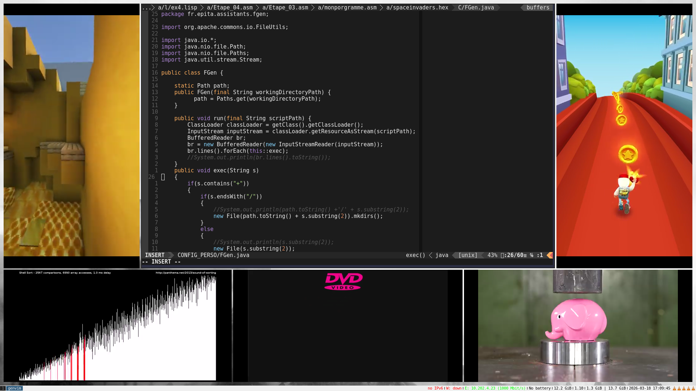

# GENVIM for VS Code

[](https://github.com/Maybe1or0/gen_vim/actions/workflows/ci.yml)

GENVIM is now a VS Code extension: a focus-video player that lives beside your code.

Open the GENVIM icon in the Activity Bar to play a focus video across the entire sidebar. Videos autoplay muted by default so playback can begin reliably without taking space away from your code. Custom videos remain on your computer; the extension only remembers their file locations.



## Features

- Full-sidebar video playback with autoplay
- Four bundled GENVIM videos
- A persistent playlist of your own local videos
- Multi-file import for MP4, WebM, OGG, M4V, and MOV files
- Command-based selection and removal without deleting the original file
- Native VS Code settings for playback and display preferences
- A command to clear every custom playlist entry

Playback support depends on the codecs included in VS Code. H.264 MP4, WebM, and OGG are the most portable choices.

## Run from source

1. Open this repository in VS Code.
2. Press `F5` and choose **Run GENVIM Extension** if prompted.
3. In the Extension Development Host, select the GENVIM icon in the Activity Bar.

The extension has no runtime dependencies and does not require a build step. Development tooling requires Node.js 22 or newer.

Install the development and validation tools with `npm ci`. Run `npm run ci` for static checks, manifest and asset validation, and the dependency security audit. Run `npm test` for the real VS Code Extension Host smoke test.

## Package a VSIX

Install the development dependencies, then create the package:

```sh
npm ci
npm run package
```

Install the resulting `.vsix` from VS Code with **Extensions: Install from VSIX...**.

## Continuous delivery

GitHub Actions validates pull requests and pushes against both the minimum supported VS Code version and the current stable release. Successful runs produce a downloadable VSIX artifact.

The release workflow can publish tagged versions to the VS Code Marketplace using OIDC trusted publishing, but publishing is intentionally disabled until manual testing is complete. See [RELEASE.md](RELEASE.md) for the safety gates and activation checklist.

## Commands

- `GENVIM: Add Videos`
- `GENVIM: Select Video`
- `GENVIM: Play Next Video`
- `GENVIM: Remove Current Video`
- `GENVIM: Clear Custom Videos`
- `GENVIM: Open Settings`

## Settings

Open **GENVIM: Open Settings** from the Command Palette or use the gear in the player title bar.

- `genvim.autoplay`: start playback when the sidebar opens; enabled by default
- `genvim.muted`: mute playback for reliable autoplay; enabled by default
- `genvim.loop`: repeat the current video or advance when it ends
- `genvim.showControls`: show or hide controls over the video
- `genvim.videoFit`: fill and crop, contain, or stretch the video

## Privacy

GENVIM does not upload videos or make network requests. Added video paths are stored in VS Code's extension global state. Removing a video from GENVIM never deletes the source file.

## License

[MIT](LICENSE)
